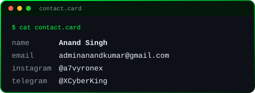

<div align="center">


<br/>

<a href="https://github.com/Anandsinghsarkar"></a>


</div>

<br/>

## About

```console
operator@sarkar:~$ cat profile.conf

name        = "Anand Singh Sarkar"
role        = "reverse engineer / tooling developer"
platform    = "windows"
interests   = ["binary analysis", "runtime research", "format parsing", "ctf"]
approach    = "read it, break it, understand it, then build better"
status      = "learning in public"

operator@sarkar:~$ _
```

<br/>

## Contact

<div align="center">

<table>
<tr>
<td valign="middle" align="center"></td>
<td valign="middle" align="center"></td>
</tr>
</table>

<a href="mailto:adminanandkumar@gmail.com"></a>
<a href="https://instagram.com/a7vyronex"></a>
<a href="https://t.me/XCyberKing"></a>

</div>

<br/>

## Focus

<table>
<tr>
<td width="50%" valign="top">

**Reverse Engineering**<br/>
Binary analysis, disassembly, debugging and figuring out how closed software actually works.

</td>
<td width="50%" valign="top">

**Runtime Research**<br/>
Process internals, memory layout, hooks and how programs behave while they run.

</td>
</tr>
<tr>
<td width="50%" valign="top">

**Tooling**<br/>
Dumpers, parsers, editors and small utilities built to make the research faster.

</td>
<td width="50%" valign="top">

**Challenges**<br/>
CTFs, wargames and practice labs to keep the skills sharp.

</td>
</tr>
</table>

<br/>

## Toolkit

<div align="center">


</div>

<br/>

## Analytics

<div align="center">


<br/>


<br/>


</div>

<br/>

## Note

All research, tooling and experiments are done for learning, in offline, lab or practice environments.

<br/>

<div align="center">

```console
[ session active ]  //  stay curious
```


</div>
