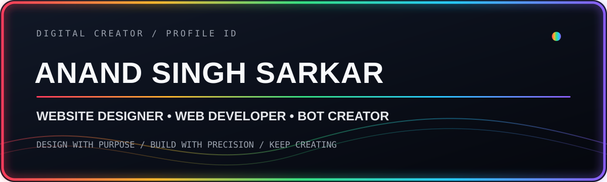

 

### ANAND SINGH SARKAR
**@Anandsinghsarkar**

 

---

## ◈ ABOUT ME

I'm **Anand Singh Sarkar** — a digital creator focused on designing websites, developing web applications and creating useful bots. I enjoy turning ideas into clean interfaces, practical tools and smooth user experiences.

> **My approach:** thoughtful design, reliable development and useful automation.

## ✦ WHAT I DO

<table>
<tr>
<td width="33%" valign="top" align="center">

### 🎨 Website Designer

Modern layouts, responsive interfaces, visual identity and user-friendly experiences.

</td>
<td width="33%" valign="top" align="center">

### 💻 Web Developer

Web applications, frontend experiences, backend integration and deployment.

</td>
<td width="33%" valign="top" align="center">

### 🤖 Bot Creator

Telegram bots, automation workflows, utility bots and bot dashboards.

</td>
</tr>
</table>

## ⌘ TECH STACK

## ◈ GITHUB OVERVIEW

 

 

## ✧ CONNECT WITH ME

---

**THANKS FOR VISITING MY PROFILE**

DESIGN • DEVELOP • CREATE • IMPROVE

